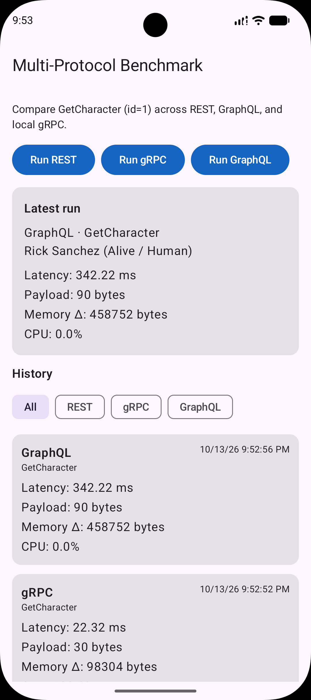

# Multi-Protocol API Benchmark

Native Android diagnostic app that compares identical `GetCharacter` queries across **REST**, **GraphQL**, and **gRPC**, capturing latency, payload size, and client memory deltas per the project SDD.



## Stack

- Kotlin, Jetpack Compose (Material 3), Clean Architecture
- Room for historical metrics
- REST: Retrofit + OkHttp (`NetworkSizeInterceptor`)
- GraphQL: Apollo Kotlin (Rick and Morty public GraphQL API)
- gRPC: gRPC-Kotlin with an **in-process** local stub (no public Rick and Morty gRPC endpoint)

## API domain

| Protocol | Endpoint |
|----------|----------|
| REST | `https://rickandmortyapi.com/api/character/{id}` |
| GraphQL | `https://rickandmortyapi.com/graphql` |
| gRPC | In-process `CharacterService.GetCharacter` stub |

gRPC latency reflects local stack cost (protobuf + channel), not internet RTT. Payload size still uses serialized protobuf bytes.

## Build & run

**Gradle JVM:** use **JDK 17** (e.g. Android Studio `jbr-17`). Gradle 8.9 does not support running on Java 25.

1. In Android Studio: **Settings → Build, Execution, Deployment → Build Tools → Gradle → Gradle JDK → `jbr-17`**
2. Sync Gradle, then run the `app` configuration on an emulator or device with network access.
3. Or from the project root (with JDK 17 on `JAVA_HOME`):

```bash
./gradlew :app:assembleDebug
```


## App usage

1. Tap **Run REST**, **Run GraphQL**, or **Run gRPC** to execute `GetCharacter` (id `1`).
2. Latest metrics appear immediately after each run.
3. Historical rows are streamed from Room and listed below (filterable by technology).
